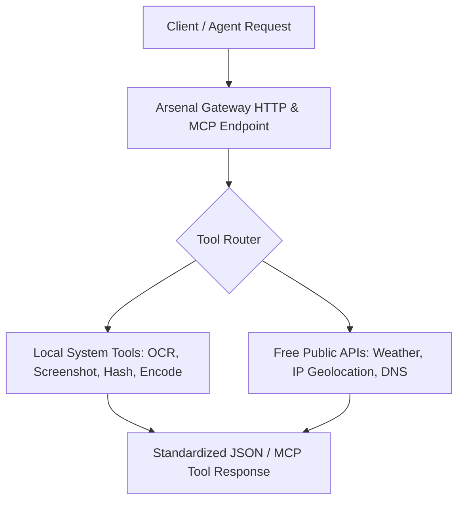

<p align="center"><a href="https://kitsunetechnologies.org/work"></a></p>

# Kitsune Arsenal

Keyless gateway for tools: wraps local utilities and free public APIs as HTTP and MCP endpoints.

[](https://github.com/KitsuneTech1/kitsune-arsenal/actions)
[](LICENSE) [](https://www.python.org/)

Kitsune Arsenal is a FastAPI service that aggregates utilities across text/encoding, web/network, geolocation, and finance. Every tool is either local or proxies a free public API. No proprietary keys required for core functionality.

## What's included

- Registry-based tool system: add a tool with one entry
- HTTP endpoints: `/tools` listing, `/health` check, and `/call/{tool}` invocation
- MCP (Model Context Protocol) manifest generation for agent integration
- 27 built-in tools covering text, encoding, web, network, geo, and finance
- Optional LibreTranslate and SearXNG backends in Docker Compose
- Bearer token authentication ready for edge deployment


## Architecture & Data Flow



## Quick start

### HTTP gateway locally

```bash
python -m pip install -r requirements.txt
python -m uvicorn app.main:app
```

Open http://localhost:8000/tools to list available tools. Call them via POST to `/call/{tool}` with a JSON body of tool parameters.

### Docker

```bash
cp .env.example .env
docker compose up
```

(On Windows, use `Copy-Item .env.example .env`.)

Gateway runs on port 8080. Add `--profile lang --profile web` to also start optional LibreTranslate and SearXNG services.

### Standalone MCP server

Run as a Model Context Protocol endpoint:

```bash
python -m pip install -r requirements-mcp.txt
ARSENAL_MCP_TOKEN=replace-with-a-token python arsenal_mcp.py
```

(On Windows: `$env:ARSENAL_MCP_TOKEN = "replace-with-a-token"`.)

Server listens on `http://localhost:8810/mcp` and requires `Authorization: Bearer <token>`.

## Tools

Core 7 keyless tools run with no backend:
- hash, UUID generation, URL slugify, current time, QR code generation, geocoding, FX rates

Full 27-tool set available in standalone MCP server, covering:
- Text: hash, UUID, slugify, encoding (base64, URL), JSON validation/diffing
- Web/Network: QR codes, URL expansion, HTTP headers, DNS, WHOIS, TLS cert inspection, IP geolocation
- Geo/Finance: geocoding, reverse geocoding, FX rates, currency conversion, cron expression parsing
- Utilities: time, TOTP, JWT decode, password generation, color conversion, regex testing, entity extraction

## Extend it

Define a new tool in the registry:

```python
register(Tool(
    name="my_tool",
    summary="What it does",
    category="Category",
    access="read",
    params={"param1": "description"},
    run=lambda param1: {"result": ...},
))
```

HTTP endpoints and MCP manifest regenerate automatically.

## Deploy

The gateway expects authentication at the edge (e.g., Caddy with Authentik forward_auth). No built-in auth; assumes trusted upstream.

## License

MIT. Copyright (c) 2025-2026 Kitsune Technologies LLC. Do what you like with it, commercially or otherwise, just keep the copyright notice. Full text in [LICENSE](LICENSE).

---

<p align="center"><sub>Part of <b>Buildtober 2026</b>: 31 open source projects in 31 days. Built by <a href="https://kitsunetechnologies.org/work">Kitsune Technologies</a>. More at <a href="https://github.com/KitsuneTech1">github.com/KitsuneTech1</a>.</sub></p>
